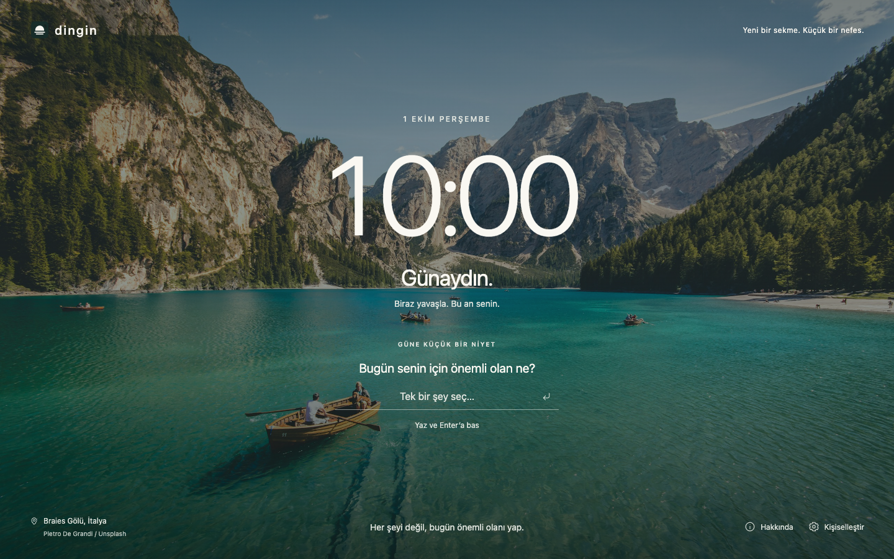

<p align="center">
  
</p>

<h1 align="center">Dingin</h1>

<p align="center">A new tab. A small breath.</p>

<p align="center">A calm, offline new tab for Brave, with a scenic background, a live clock, and one daily focus.<br>No accounts, tracking, or extra browser permissions.</p>



**Dingin** means calm in Turkish. It turns each new tab into a quiet moment to check the time, take a breath, and choose what matters today. The interface is in Turkish; this guide is in English.

Built with plain HTML, CSS, and JavaScript using Manifest V3. Everything needed to run the extension is inside [`extension/`](extension/). No build step, server, or API key is required.

## Features

- **A local clock and date.** Choose 12-hour or 24-hour time, with greetings that follow the time of day and optionally include your name.
- **One daily intention.** Save, complete, edit, or remove a single focus. It resets at local midnight, including when a suspended tab wakes up.
- **Three quiet backgrounds.** A bundled photograph of Lake Braies, a dusk gradient, and a night gradient.
- **A daily reminder.** A short, gentle thought that changes with the local calendar day.
- **Preferences that stay with you.** Your name, clock format, and background persist in the browser. Open Dingin tabs in the same profile stay in sync.
- **An About panel.** Learn what Dingin does, how it stores your information, and where to find the source code.
- **Keyboard access and responsive layouts.** Labeled controls, visible focus indicators, accessible dialogs, and layouts that adapt to narrow windows.
- **Offline by design.** All images, icons, styles, and scripts are bundled. No remote fonts, analytics, ads, or background services.

## Install in Brave

Use Brave on a **Windows, macOS, or Linux desktop**. Installation does not require Node.js or a terminal.

1. [Download the project ZIP](https://github.com/TemelGunaydin/Dingin/archive/refs/heads/main.zip) and extract it. You can also clone the repository:

   ```bash
   git clone https://github.com/TemelGunaydin/Dingin.git
   ```

2. Move the extracted project to a permanent location. Brave will continue reading the extension from this folder.
3. Open `brave://extensions` in Brave's address bar.
4. Enable **Developer mode** in the top-right corner.
5. Click **Load unpacked** and select the **`extension` folder**, which directly contains `manifest.json`. Select the folder, not the ZIP, the repository root, or an individual file.
6. Open a new tab with **Cmd+T** on macOS or **Ctrl+T** on Windows and Linux. If Brave asks you to confirm the new tab change, choose **Keep it**.

You should now see the lake background and a large clock. If another extension controls your new tab page, disable that extension first.

> Keep the installed `extension` folder in place. Moving or deleting it will stop the unpacked extension from working.

## Make it yours

### Personalize your space

Click the **gear icon** in the footer. Add an optional name, choose your clock format, and select a background. Save to apply your preferences, or press **Escape** to leave them unchanged.

The 12-hour clock uses Turkish period markers for morning and afternoon. The time, date, greetings, and daily reset all use your computer's local time zone.

### Choose today's focus

Enter one intention beneath the clock, then press **Enter** or click the save icon. Click the circle next to it to mark it complete; click again to reopen it.

Use the **pencil icon** to edit. While editing, press **Enter** to save, use **Escape** or Cancel to discard your edit, or choose Remove to clear today's focus. The focus field supports up to 160 characters.

At local midnight, the focus resets for a fresh day. Your name and preferences remain. Dingin keeps one daily intention, rather than a history of completed tasks.

### Learn about Dingin

Click the **information icon** in the footer to open About. It explains the project's purpose, offline behavior, and local storage, and links to this repository. Close it with the close button, **Escape**, or a click outside the panel. Keyboard focus returns to the control that opened it.

## Privacy and offline behavior

- The extension requests **no browser permissions or host access**.
- Names, preferences, and the daily focus are stored in the extension's `localStorage`. They stay in the current browser profile and are not uploaded or synced between devices.
- Tabs in the same browser profile synchronize saved changes through the browser's storage events. Unsaved edits are kept while preferences change in another tab.
- The content security policy blocks outgoing connections with `connect-src 'none'`. Scripts, styles, and images are restricted to bundled assets.
- The photo credit and repository links open external pages only when you click them.
- If browser storage is unavailable, Dingin remains usable with temporary, in-memory state and displays a notice. Those changes last only in the current tab.

## Update or uninstall

To update, replace the files in the **same installed folder**, open `brave://extensions`, and click **Reload** on Dingin's card. Open a fresh new tab to see the changes. Reloading keeps your saved preferences and current daily focus.

To temporarily return to Brave's default new tab, switch Dingin off on the extensions page. Turn it back on to use it again. Use **Remove** to uninstall; uninstalling may delete the extension's saved data.

## Troubleshooting

| Problem | What to check |
| --- | --- |
| **Load unpacked** is missing. | Enable **Developer mode** at `brave://extensions`. |
| Brave cannot find or read the manifest. | Extract the ZIP and select the `extension` folder that directly contains `manifest.json`. |
| Dingin is installed, but a new tab looks unchanged. | Enable Dingin, disable competing new tab extensions, confirm Brave's new tab prompt if shown, and open a fresh tab. |
| The extension stopped working after moving its folder. | Restore the original folder location and reload. Loading it from a new location may require reinstalling and can reset saved data. |
| The clock or date is incorrect. | Check the computer's clock, date, and time zone. |
| Yesterday's focus disappeared. | The daily focus intentionally resets at local midnight. |
| A storage notice appears. | The browser profile or a privacy tool may be blocking local storage. Changes will remain temporary in the current tab. |
| Installation is blocked on a work or school computer. | Ask your administrator whether unpacked extensions are permitted. |

## Development

Use **Node.js 20 or later**. The extension itself has no runtime dependencies; Playwright is a development dependency for browser tests.

```bash
npm ci
npm test
npm run test:browser
```

The browser suite uses Brave automatically when installed at its standard macOS location. It launches a separate temporary profile, loads the actual extension as the new tab page, and runs offline. It does not use your personal Brave profile.

On another system, point the suite to your Brave executable:

```bash
BROWSER_PATH="/path/to/brave" npm run test:browser
```

If Brave is unavailable, install Playwright's Chromium:

```bash
npx playwright install chromium
npm run test:browser
```

Model tests cover date boundaries, formatting, input normalization, malformed data, and bundled assets. Browser tests cover the actual new tab override, offline loading, focus actions, persistence, midnight rollover, synchronization, blocked storage, About interactions, keyboard focus, and narrow layouts. Preview screenshots are written to `test-results/`.

### Project structure

```text
extension/
  manifest.json       # Manifest V3, new tab override, and security policy
  newtab.html         # New tab, personalization, and About dialogs
  newtab.css          # Layout, backgrounds, and responsive styles
  newtab.js           # Clock, storage, dialogs, and tab synchronization
  model.js            # Date formatting and data validation
  assets/             # Bundled photograph, generated logo, and icons
tests/
  model.test.js       # Node.js model and packaging tests
  newtab.spec.js      # Playwright tests in the actual extension
docs/
  preview.png         # New tab screenshot
  branding.md         # Logo generation prompts and asset details
```

## Credits

**Photography:** Lake Braies, Italy, by [Pietro De Grandi on Unsplash](https://unsplash.com/photos/T7K4aEPoGGk), used under the [Unsplash License](https://unsplash.com/license). The [source photograph](https://images.unsplash.com/photo-1501785888041-af3ef285b470?auto=format&fit=crop&w=2560&q=88) is bundled locally and is not fetched during use.

**Logo:** A sunrise reflected in still water, created with OpenAI's built-in image generation tool. The logo and matching extension icons are bundled locally. See [branding notes and prompts](docs/branding.md).

Dingin is an independent project inspired by Momentum. It is not affiliated with or endorsed by Momentum or Brave.
